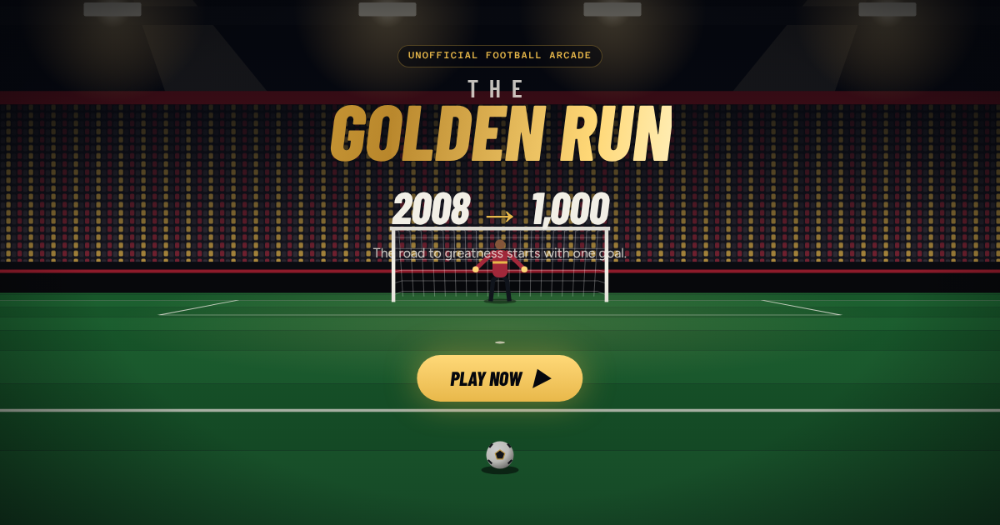
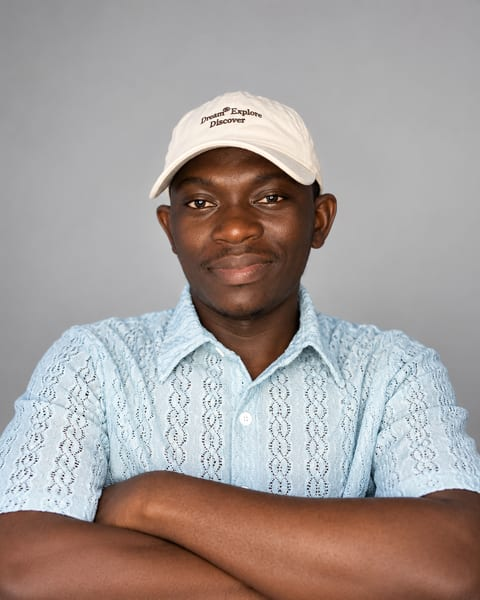

  

<h1 align="center">The Golden Run</h1>

  <b>2008 → 1,000.</b> <i>The road to greatness starts with one goal.</i> 
  A free football arcade game you play in your browser.

  <a href="https://goldenrun.fun"><b>▶ Play now at goldenrun.fun</b></a>

---

## The story behind The Golden Run

It started with a legendary year.

In 2008, Cristiano Ronaldo won his first Ballon d’Or. It became one of the defining moments of an extraordinary football career. Years later, as football fans returned to that achievement and Ronaldo continued his pursuit of 1,000 career goals, an idea began to take shape.

*What if fans could experience a journey of their own?*

My first thought was simple: a football game where the first player to reach 1,000 goals would earn the title of the ultimate Golden Fan. The more I thought about it, the more I realized that reaching a number shouldn’t be the only thing that mattered.

> **The journey needed to be fun. The goals needed to feel earned. And the competition needed to reward skill.**

So instead of a goal counter, I built a proper arcade football game: a ball, a goalkeeper, a stadium, precise shooting, difficult saves, and those moments when a perfectly placed shot makes you want to celebrate.

A legendary journey inspired the idea. **The next goal belongs to you.**

— Mojeeb · [Read the full story](https://goldenrun.fun/about)

## How to play

Put your finger (or mouse) on the ball, drag toward the goal and let go.

- **Drag** to shoot. The direction aims, and the length sets the power.
- **Bend** your swipe and the ball curls the same way, round the keeper.
- **Strike** low on the ball to lift it toward the top corner, or high to keep it down.

The game teaches all three in a few seconds the first time you play. On a keyboard: ← → aim · ↑ ↓ height · W/S power · Q/E curl · Enter to shoot.

## Ways to play

| | |
| --- | --- |
| **Practice** | Open to everyone, no sign-up. Pick your keeper (Rookie, Professional or Legendary) and a spot, and shoot as long as you like. |
| **2008: The Beginning** | Six fictional matchdays, from your debut under the floodlights to cup final night. Score 42 verified goals to earn the 2008 badge. |
| **Road to 1,000** | Career runs on courses chosen by the server. Every verified goal counts once, with milestone badges at 42, 100, 250, 500, 750 and 1,000. The first player to reach 1,000 becomes the **Founding Golden Fan**. |
| **Golden Cup** | The same twelve shots for everyone each week, with four minutes on the clock and one ranked try. The best verified score wins the week. |
| **Leaderboards** | Weekly, country and career rankings, plus a Hall of Fame. |

Practice needs nothing. For goals that count, create a free player in seconds: there's no email or password, and you sign in with your phone's Face ID, fingerprint or screen lock (a passkey).

## Fair play

Your device sends only the inputs of each shot. Our server replays every shot with the same physics and goalkeeper and decides the result, so scores can't simply be made up. Unusual results are held for review before they reach a leaderboard. Titles, badges and trophies are unofficial in-game recognition with no cash prizes and nothing to buy. Full details: [rules](https://goldenrun.fun/rules) · [terms](https://goldenrun.fun/terms) · [privacy](https://goldenrun.fun/privacy).

## Made by

**[Mojeeb Titilayo](https://mojeeb.xyz)**, product engineer and strategist, conceived and built The Golden Run. He enjoys turning unexpected ideas into real, usable experiences. Follow [@MojeebMotion](https://x.com/MojeebMotion) on X.

The game is published by **[BlindspotLab Limited](https://blindspotlab.xyz)**, an AI-native product studio focused on turning ideas into working products.

 

## Support and reports

Questions, feedback, account help, bug reports or a dispute about a result: email **[mojeeb@blindspotlab.xyz](mailto:mojeeb@blindspotlab.xyz)**. To flag a nickname or suspected cheating, use **Report player** on any profile in the game.

## License and independence

© 2026 BlindspotLab Limited. All rights reserved. The source code is licensed under the [Apache License 2.0](LICENSE). See [NOTICE](NOTICE): the licence doesn't cover the creator portrait, or The Golden Run name and branding. Third-party software and fonts remain under their own licences.

The Golden Run is an unofficial, independent fan game. It is not affiliated with, endorsed by or connected to Cristiano Ronaldo, any other player, club, league or competition, or the Ballon d’Or and its organisers. Names and trademarks belong to their respective owners. All artwork and sound are original.

Technical documentation lives in [docs/DEVELOPMENT.md](docs/DEVELOPMENT.md).
